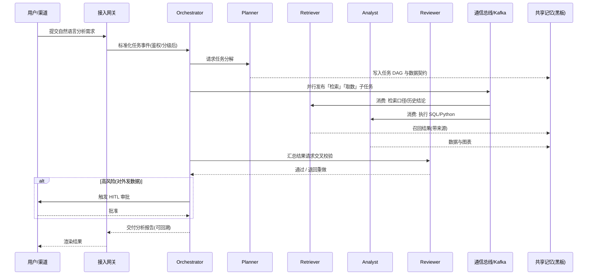

# 多 Agent 接入协作项目方案书

> 本文档为合订本，完整收录产品需求、系统架构设计、实施路线图与风险评估四部分；各部分亦按目录独立存放于「产品需求」「架构设想」「当前进度」三个文件夹。

---

## 1. 产品需求（Product Requirements）

### 1.1 核心场景定义

本项目定位为**企业级多 Agent 智能协作平台**：以一个中央调度 Agent（Orchestrator）统筹多个具备专属技能的专家 Agent，通过任务分解、并行执行、交叉校验与人工介入，将过去需要多人跨岗位协同完成的复杂知识工作，改造为「一次提需求、多 Agent 自动交付、关键节点人工确认」的自动化流水线。

平台采用「通用编排内核 + 可插拔业务 Agent」的设计，不绑定单一业务，首批落地以下 4 个高价值场景：

| 场景 | 触发方式 | 协作链路（Agent 流转） | 最终交付物 |
| :--- | :--- | :--- | :--- |
| **数据分析流水线** | 用户用自然语言提出分析诉求 | 规划 Agent → 取数 Agent → 分析 Agent → 图表 Agent → 评审 Agent | 带图表与结论的分析报告 + 可回溯 SQL |
| **智能客服与工单** | IM / 工单系统接入 | 接待 Agent → 检索 Agent（知识库 RAG）→ 业务办理 Agent →（必要时）人工坐席 | 客户答复 + 自动建工单 + 处理记录 |
| **代码生成协作** | 提交 Issue / 需求描述 | 规划 Agent → 编码 Agent → 测试 Agent → 评审 Agent →（人工 Merge） | 可运行代码 + 单元测试 + 评审意见 |
| **报告/文档自动化** | 输入主题与素材 | 检索 Agent → 规划 Agent → 写作 Agent → 审校 Agent →（人工签发） | 结构化正式文档（Markdown/Word/PDF） |

**目标用户与角色：**

- **业务人员（运营/市场/管理）**：自然语言提需求，获取分析与文档，不接触技术细节。
- **研发/数据工程师**：提交代码、取数、排障任务，使用平台生成的可追溯中间产物。
- **审核/管理者**：在关键节点（对外发数据、合并代码、签发文档）进行人工审批（Human-in-the-loop）。
- **平台管理员**：配置 Agent、工具权限、模型配额、审计策略与成本看板。

**核心业务价值（可量化指标）：**

- 数据分析任务平均交付时长由 **4 小时缩短至 30 分钟以内**；
- 客服首响时间 < **3 秒**，常见问题自动闭环率 ≥ **70%**；
- 标准化文档生成耗时下降 ≥ **60%**，一次审校通过率 ≥ **80%**；
- 全链路可追溯：每个结论可回溯到来源数据、调用工具、模型版本与责任 Agent。

### 1.2 功能模块清单

**1.2.1 任务接入与会话模块**
- **多渠道接入网关**：统一接入 Web 控制台、企业 IM（飞书/钉钉/企微）、REST API、工单系统 Webhook；将不同渠道消息归一化为标准任务事件。预期价值：业务零改造接入。
- **意图理解与任务分诊**：对输入做意图分类、参数抽取、紧急度/敏感度分级。预期价值：自动路由到正确流程，敏感任务自动升级管控。
- **多轮会话管理**：维护会话上下文、追问澄清、会话断点续接。预期价值：支持模糊需求的渐进澄清。

**1.2.2 任务规划与编排模块**
- **任务分解（Plan-and-Solve）**：将复杂目标拆解为带依赖关系的 DAG 子任务图，明确每个子任务的负责 Agent、输入输出契约（Schema）与验收标准。
- **动态重规划**：子任务失败或结果不达标时，自动重新分解、更换 Agent 或补充检索步骤。
- **编排可视化**：以流程图实时展示任务 DAG、执行状态、当前节点与耗时。预期价值：过程透明、可人工干预。

**1.2.3 Agent 调度与协作模块**
- **中央调度（Orchestrator）**：按 DAG 路由分发子任务，解决 Agent 间的资源争用与结论冲突。
- **专家 Agent 池**：检索、编码、分析、测试、评审、写作等可插拔 Agent，支持热加载与版本管理。
- **协作模式库**：内置串行流水线、并行竞速（Race）、投票（Voting）、多 Agent 辩论（Debate）、反思（Reflection）等模式。
- **人工介入（HITL）**：在高风险节点暂停并推送审批，支持批准、驳回、改写、转人工。

**1.2.4 记忆与知识管理模块**
- **短期工作记忆**：单次任务内的中间结果、变量与步骤状态（Redis + 图状态 Checkpoint）。
- **长期共享记忆**：跨会话沉淀的事实、用户偏好、历史结论，基于向量库语义检索（含来源与时效）。
- **企业知识库（RAG）**：接入文档、Wiki、数据库 Schema、FAQ，支持增量索引与权限隔离。
- **黑板（Blackboard）**：所有 Agent 共享的任务工作区，任一 Agent 写入后其他 Agent 可订阅。

**1.2.5 工具调用与集成模块**
- **统一工具协议**：基于 MCP（Model Context Protocol）+ Function Calling 接入搜索、数据库、HTTP API、代码执行、文件处理等工具。
- **代码执行沙箱**：隔离运行 Python/SQL/脚本，限制网络、文件系统与资源配额。
- **企业系统连接器**：数据库、Git、Jira、工单、对象存储、邮件等开箱即用连接器。

**1.2.6 安全与合规模块**
- **统一认证与权限（RBAC + ABAC）**：用户、Agent、工具三级权限，按角色 + 数据属性（密级/部门）双重判定。
- **输入过滤与提示注入防护**：对用户输入与外部检索内容做敏感词、越权指令、Prompt Injection 检测与隔离。
- **输出审计与脱敏**：对外输出经规则 + 模型双层校验，自动脱敏身份证、手机号、密钥、财务数据。
- **数据隐私与留存**：数据分级分类、传输/存储加密、可配置留存周期与删除策略，支持私有化部署。

**1.2.7 可观测与运营模块**
- **全链路追踪**：每次任务记录 Agent、模型、Prompt、工具调用、Token、耗时与产物，支持 OpenTelemetry 链路。
- **成本与配额管理**：按部门/用户/Agent 统计 Token 与费用，设置预算与限流。
- **质量评测与回归**：维护场景评测集，对模型/Prompt/Agent 版本做离线打分与灰度对比。
- **监控告警**：对成功率、延迟、异常率、工具失败率设置阈值告警。

**1.2.8 多模型网关模块**
- **统一模型路由**：一套接口对接多家大模型，按任务难度与成本选择模型。
- **降级与负载均衡**：供应商故障自动切换，高峰期排队与限流，支持私有化模型兜底。
- **Prompt 与版本管理**：集中管理各 Agent 的系统提示词、模板与版本，支持灰度与回滚。

### 1.3 Agent 角色体系

| Agent 角色 | 职责定义 | 技能/工具集 |
| :--- | :--- | :--- |
| **调度编排 Agent（Orchestrator）** | 全局任务路由、DAG 调度、冲突仲裁、异常重规划、人工节点触发；不直接产出业务内容 | 规划引擎、状态机、DAG 运行时、HITL 接口、配额熔断 |
| **需求规划 Agent（Planner）** | 澄清需求、任务拆解、定义子任务输入输出契约与验收标准 | Plan-and-Solve / CoT、Schema 校验、澄清话术库 |
| **知识检索 Agent（Retriever）** | 企业知识库与外部信息检索、多路召回、重排序、来源标注 | 向量检索、关键词检索、Reranker、网页/文档连接器、SQL 元数据查询 |
| **数据分析 Agent（Analyst）** | 取数、清洗、统计建模、归因分析、生成图表与结论 | SQL 执行、Python（pandas/numpy）、图表库、指标口径库 |
| **编码 Agent（Coder）** | 按需求生成/修改代码、编写脚本、修复缺陷 | 代码生成、Git、文件读写、语言运行时、依赖管理 |
| **测试 Agent（QA）** | 生成单元/集成测试、执行用例、回归验证、报告缺陷 | 测试框架、沙箱执行、覆盖率工具、Mock 服务 |
| **评审 Agent（Reviewer/Critic）** | 对其他 Agent 的产物交叉校验，识别幻觉、逻辑错误、安全与合规问题 | Reflection / 辩论模式、规则引擎、事实核查、静态检查 |
| **写作 Agent（Writer）** | 生成报告、文档、客服话术，按模板与风格要求成稿 | 模板引擎、文档转换（Markdown/Word/PDF）、风格规范库 |
| **业务办理 Agent（Operator）** | 在客服场景调用业务系统完成查询、下单、改单、建工单等动作 | 业务 API、工单系统、表单填写、二次确认机制 |
| **安全审计 Agent（Guardian）** | 独立于业务链路，对输入、工具调用、输出进行安全与合规审计与拦截 | 输入过滤、脱敏、DLP、权限判定、审计日志写入 |

**协作机制约定：**

1. **单一事实源**：所有子任务结果写入共享黑板，Agent 不直接互相传递私有状态，避免状态分叉。
2. **契约先行**：子任务之间以结构化 Schema（JSON Schema / Pydantic）传递数据，校验失败即退回重做。
3. **关键节点必审**：涉及对外发送、资金/数据变更、代码合并、文档签发的节点，强制经评审 Agent + 人工双重确认。
4. **预算与步数约束**：每个任务设置最大执行步数、最大 Token 与最大重试次数，超限自动熔断并转人工。

---

## 2. 系统架构设计（System Architecture）

### 2.1 总体架构图示

系统采用「分层解耦、事件驱动、状态外置」的微服务架构，自上而下分为七层。所有 Agent 均为无状态计算单元，任务状态统一外置到状态存储与共享记忆，实现任意实例可水平扩展、故障可重放。

```
┌──────────────────────────────────────────────────────────────────────────┐
│  表现层 Presentation   Web 控制台 │ 企业 IM(飞书/钉钉/企微) │ OpenAPI/SDK │ 工单系统
├──────────────────────────────────────────────────────────────────────────┤
│  接入网关层 Gateway     API 网关(Kong/APISIX) │ 认证鉴权 │ 限流熔断 │ 渠道适配
├──────────────────────────────────────────────────────────────────────────┤
│  应用层 Application     任务管理 │ 会话管理 │ 编排服务 │ HITL 审批 │ 配额计费
├──────────────────────────────────────────────────────────────────────────┤
│  智能层 Agent Layer                                                    │
│   ┌─────────────┐   规划Planner │ 检索Retriever │ 分析Analyst │ 编码Coder    │
│   │ Orchestrator│──▶测试QA │ 评审Reviewer │ 写作Writer │ 办理Operator │ 审计Guardian│
│   │ (DAG 状态机) │      （无状态专家 Agent 池，K8s 弹性伸缩，灰度版本）          │
│   └─────────────┘                                                         │
├──────────────────────────────────────────────────────────────────────────┤
│  能力层 Capability   大模型网关 LLM Gateway │ 工具执行沙箱(MCP) │ RAG 检索引擎
├──────────────────────────────────────────────────────────────────────────┤
│  通信层 Messaging     Kafka(事件流) │ gRPC(同步) │ Redis Stream │ A2A/JSON-RPC
├──────────────────────────────────────────────────────────────────────────┤
│  数据层 Data           PostgreSQL(元数据) │ Redis(会话/短期记忆)             │
│                        向量库 Milvus(长期记忆/Knowledge) │ MinIO(产物/文件)   │
│                        Neo4j(知识图谱,可选) │ Vault(密钥) │ 审计日志(只增)    │
├──────────────────────────────────────────────────────────────────────────┤
│  基础设施 Infra    Kubernetes │ Istio │ Prometheus+Grafana │ Loki │ OTel │ CI/CD
└──────────────────────────────────────────────────────────────────────────┘
           安全纵贯：认证授权(RBAC+ABAC) │ 输入过滤 │ 输出审计脱敏 │ 数据加密 │ 隐私合规
```

**任务执行时序（以数据分析流水线为例）：**



### 2.2 核心组件说明

**2.2.1 调度中心（Orchestrator）**
- **职责**：任务路由分发、DAG 状态推进、并行/串行编排、冲突解决、异常重规划、人工节点触发。
- **实现方式**：基于 **LangGraph 的图状态机（StateGraph）** 作为主编排内核。每个节点是一个 Agent 或工具调用，边表达依赖与条件分支；利用 LangGraph 的 **Checkpointer** 将图状态持久化到 PostgreSQL，支持任务暂停、断点续跑、时间旅行调试（重放/回滚）。
- **路由分发**：Planner 产出的 DAG 经校验后，由 Orchestrator 按节点就绪度向 Kafka 投递子任务；同层无依赖节点并行执行，竞速（Race）场景取最快合格结果。
- **冲突解决**：多 Agent 结论冲突时，采用「Reviewer 仲裁 + 证据引用数 + 置信度」加权裁决；仍不可判定则升级人工，不静默二选一。
- **熔断保护**：每个任务携带 `max_steps`、`max_tokens`、`max_retries`、`deadline` 四大约束，由 Orchestrator 统一计数，超限即熔断。

**2.2.2 共享记忆库（Shared Memory）**

采用**三层记忆 + 单一黑板**架构，状态外置、读写分离：

| 记忆层级 | 载体 | 生命周期 | 内容 | 一致性策略 |
| :--- | :--- | :--- | :--- | :--- |
| **工作记忆（短期）** | Redis + LangGraph Checkpoint | 单次任务 | 中间变量、步骤状态、DAG 运行态 | 任务内强一致，TTL 过期 |
| **黑板（Blackboard）** | Redis Hash/Stream + PG 落盘 | 单次任务 | 各 Agent 共享产物，支持订阅通知 | 条目级版本号（乐观锁） |
| **长期记忆** | Milvus 向量库 + PostgreSQL | 跨会话持久 | 事实、用户偏好、历史结论、知识条目 | 带来源、时间、密级；可删除/更正 |

- **写入**：Agent 产物先经 Schema 校验与 Reviewer 抽检，再写入黑板；被标记为「可沉淀」的结论经清洗后向量化入长期记忆。
- **检索**：长期记忆采用「向量召回（bge-m3）+ 关键词 BM25 混合检索 + Reranker 精排」，返回结果必须携带 `source / timestamp / confidence`，并按用户数据权限做行级过滤。
- **遗忘与合规**：支持按用户/数据源删除（满足删除权）、TTL 自动过期、记忆条目审计，避免错误记忆永久污染。

**2.2.3 通信总线（Communication Bus）**

同步与异步分离，按场景选型：

| 通信方式 | 技术 | 适用场景 | 关键机制 |
| :--- | :--- | :--- | :--- |
| **异步事件流（主）** | **Kafka** | 子任务分发、Agent 解耦、削峰、事件回放 | 按 `task_id` 分区保证同任务有序；消费者组弹性扩缩；至少一次投递 + 幂等消费 |
| **同步调用** | **gRPC** | Orchestrator 对 Planner/Reviewer 的实时短调用、内部服务间高性能通信 | Protobuf 契约、超时/重试/熔断 |
| **轻量即时消息** | Redis Stream | 黑板变更通知、HITL 实时推送、低延迟协作 | 消费组 + 消息确认 |
| **Agent 互操作** | **A2A（Agent2Agent）/ JSON-RPC over HTTP** | 跨团队/外部 Agent 能力互通、标准化 Agent Card 发现 | 任务对象（Task）生命周期、制品（Artifact）交换 |
| **工具接入** | **MCP（Model Context Protocol）** | Agent 对接外部工具与上下文资源 | 标准化 tools/resources/prompts，工具白名单 |

- **状态同步**：以「事件溯源（Event Sourcing）」为唯一事实源——所有状态变更产生不可变事件写入 Kafka 与审计库，当前状态由事件回放得出；任一副本重启后依据 Checkpoint + 事件追平，杜绝多副本状态不一致。
- **幂等与补偿**：每个子任务携带全局幂等键 `task_id + node_id + attempt`；写操作天然幂等；跨工具的长事务采用 **Saga 模式 + 补偿动作**，失败可回滚已执行步骤。

**2.2.4 大模型网关（LLM Gateway）**
- 统一 OpenAI 兼容接口，后端接入 GPT/Claude 等海外模型与 DeepSeek、Qwen、豆包等国产模型及私有化部署模型。
- **分级路由**：简单分类/抽取走小模型（低成本低延迟），复杂规划/推理走强推理模型；按任务标签自动选模，失败按优先级链降级。
- 提供：负载均衡、供应商健康检查、自动重试与熔断、流式转发、Token 与成本计量、Prompt 模板与版本中心、敏感词前置拦截、全量请求落盘（加密）用于审计与回放。

**2.2.5 工具执行沙箱（Tool Sandbox）**
- Agent 生成的代码/SQL 在隔离沙箱执行：容器级隔离（gVisor / 容器 NetworkPolicy 禁外网白名单）、只读根文件系统、临时可写卷、CPU/内存/超时配额、无持久凭证。
- 工具按最小权限授权，高危工具（删改数据、外发、支付）强制二次确认与 HITL。
- 所有工具调用记录入参、出参、执行者与结果，供审计与重放。

**2.2.6 安全中心（Guardian，横切所有层）**
- **认证授权**：OIDC/OAuth2 统一认证；RBAC 管角色、ABAC 管数据属性（密级/部门/owner），Agent 以其「服务身份 + 发起人身份」双重继承权限，禁止越权访问数据。
- **输入过滤**：在网关与 RAG 召回两道关口做 Prompt Injection、越权指令、敏感内容检测；外部检索内容以「不可信数据」隔离标注，禁止其中的指令被执行。
- **输出审计**：结构化输出校验 + DLP 数据防泄漏（身份证/手机号/银行卡/密钥/财务数字正则与模型双识别）+ 脱敏后外发；高风险输出强制 HITL。
- **数据隐私**：传输 TLS 1.3、存储 AES-256、密钥由 Vault 管理；支持租户级数据隔离、私有化/离线部署、数据留存与删除策略、操作审计日志只增不改。
- **供应链安全**：第三方工具/MCP Server 白名单与签名校验，容器镜像扫描，最小镜像与非 root 运行。

### 2.3 技术栈选型

**大模型层**
- **主力模型（多供应商可切换）**：DeepSeek-R1/V3、Qwen3、豆包 Doubao（推理与中文业务），GPT/Claude（复杂规划与代码，按合规与网络条件选用）；私有化兜底采用 Qwen/DeepSeek 开源权重本地部署。
- **Embedding**：bge-m3（多语种、稠密+稀疏向量）；**Reranker**：bge-reranker-v2；**轻量分类**：Qwen 小尺寸模型。
- **网关**：自研/基于 LiteLLM Proxy + 自研路由策略的统一 LLM Gateway。

**Agent 框架选型（三者分工，非互斥）**

| 框架 | 特性 | 在本项目中的定位 |
| :--- | :--- | :--- |
| **LangGraph** | 图状态机、Checkpoint 持久化、HITL、流式、可重放，工程化程度高 | **主编排内核**：承载 Orchestrator 与生产级 DAG 工作流 |
| **AutoGen** | 对话驱动多 Agent、GroupChat、人机协作，适合开放式协同探索 | 用于「多 Agent 辩论/评审」与需要自由对话协商的子环节 |
| **CrewAI** | Role/Task/Crew 角色化建模，上手快、业务流程表达直观 | 用于新业务场景的快速原型（POC）验证，成熟后迁移到 LangGraph |

**后端框架与语言**
- **核心服务**：Python 3.11 + **FastAPI**（Agent 与编排生态，异步）；高并发网关/渠道路由用 **Go**（Gin/gRPC）补充。
- **RPC 契约**：gRPC + Protobuf；对外 REST 由 grpc-gateway / FastAPI 暴露。
- **任务调度**：LangGraph Runtime + Kafka 消费者；定时任务用 Celery beat / 自研 Scheduler。

**数据与中间件**
- **关系/元数据库**：PostgreSQL 16（任务、DAG、Checkpoint、权限、审计索引）。
- **缓存/会话/黑板**：Redis 7（Cluster 模式）。
- **向量数据库**：Milvus（规模化长期记忆与知识库）；早期可用 pgvector 平滑过渡。
- **消息队列**：Kafka（事件流主骨干）；Redis Stream 补轻量通知。
- **对象存储**：MinIO（产物文件、图表、文档、请求留档）。
- **知识图谱（可选）**：Neo4j，用于复杂实体关系与根因分析场景，非 MVP 必需。
- **密钥管理**：HashiCorp Vault。

**基础设施与可观测**
- **运行时**：Docker + Kubernetes（HPA 按队列长度/CPU 弹性扩缩 Agent Worker）。
- **服务网格**：Istio（mTLS、流量治理、熔断、灰度）。
- **监控指标**：Prometheus + Grafana（成功率、延迟、Token 成本、队列堆积、工具失败率）。
- **日志**：Promtail/Loki + 审计专用只增存储。
- **链路追踪**：OpenTelemetry（以 `task_id` 贯穿网关→编排→Agent→模型→工具全链路）。
- **IaC 与流水线**：Terraform + GitLab CI/GitHub Actions（代码扫描、镜像构建、自动化测试、灰度发布）。
- **质量保障**：LangSmith / 自研评测平台做 Prompt 与链路版本的离线评测、回归与灰度对比。

**前端**
- React 18 + TypeScript + Vite；DAG/任务流可视化使用 **React Flow**；图表用 ECharts；编辑器用 Markdown 编辑器 + 代码高亮；支持 SSE/WebSocket 流式输出与审批待办。

**部署形态**
- **默认**：Kubernetes 私有化部署（满足数据不出域）；
- **提供**：单机 docker-compose（开发/演示）、Helm Chart（生产）；
- **多租户**：命名空间 + 数据库行级策略 + 向量库分区实现逻辑隔离，强隔离场景采用独立租户命名空间。

### 2.4 架构对关键非功能需求的支撑

| 非功能需求 | 设计手段 |
| :--- | :--- |
| **高可用** | Agent 无状态多副本 + K8s 自愈；Kafka/PG/Redis/向量库集群化；模型多供应商降级；状态外置支持实例故障后任务重放 |
| **可扩展** | Agent 与工具均为插件，按统一契约热注册；能力层与业务层解耦，新增场景仅需新增 Agent/图定义 |
| **一致性** | 事件溯源单一事实源 + 幂等键 + 乐观锁 + Saga 补偿，保证多 Agent 协作无状态分叉 |
| **可观测** | 全链路 OTel + 任务/成本看板 + 只增审计日志，每结论可回溯来源、模型版本与责任 Agent |
| **安全合规** | 三级权限 + 双道输入过滤 + 输出 DLP 审计 + 沙箱隔离 + 加密与 Vault + 私有化部署 |
| **成本可控** | 模型分级路由 + Token 预算熔断 + 语义缓存（相似问题命中）+ 小模型前置，整体成本可配额、可预警 |

---

## 3. 当前进度与实施路线图（Project Roadmap）

### 3.1 总体策略与节奏

采用 12 周三阶段、敏捷迭代（2 周一个 Sprint）推进，坚持**垂直切片、每周可演示、接口契约先行**：每阶段结束都产出可运行、可验收的增量，而非横向堆积技术组件。人员按「编排/平台组、Agent/算法组、工程/基础设施组、前端/体验组」四线并行。

| 阶段 | 周期 | 核心目标 | 出口标准（Definition of Done） |
| :--- | :--- | :--- | :--- |
| **阶段一 MVP 验证期** | Weeks 1–4 | 跑通单场景单链路协作 | 数据分析场景端到端 Demo 可演示，成功率 ≥ 80% |
| **阶段二 协同深化期** | Weeks 5–8 | 动态编排 + 多 Agent 协同 + 人机协同 | ≥ 3 场景可用，DAG 动态重规划与 HITL 生效 |
| **阶段三 生产部署期** | Weeks 9–12 | 高可用、安全加固、可观测、灰度上线 | 通过安全/性能验收，SLA 达标，灰度转正式发布 |

### 阶段一：MVP 验证期（Weeks 1–4）

- **目标**：用最小链路验证「规划 → 检索/取数 → 分析 → 产出」的技术可行性，打通模型网关、LangGraph 编排、工具调用与最小前端。
- **范围收敛**：只做「数据分析流水线」1 个场景；仅接入 1 个主模型 + 1 个备模型；工具仅开放 SQL 查询、Python 沙箱、知识库检索 3 项。

| 周次 | 关键任务 | 负责线 |
| :--- | :--- | :--- |
| **W1** | 需求冻结与接口契约定义（任务/Agent/工具 JSON Schema）；代码仓库、CI/CD、docker-compose 环境搭建；LLM Gateway 打通主备两个模型，完成统一调用与降级 | 平台组 / 工程组 |
| **W2** | 基于 LangGraph 实现 Planner、Retriever、Analyst 三个 Agent 的串行链路；落地任务状态 Checkpoint（PostgreSQL）；短期记忆（Redis） | Agent 组 / 平台组 |
| **W3** | 接入 SQL/Python 沙箱与知识库 RAG（bge-m3 + 向量库，MVP 可用 pgvector）；最小 Web 控制台：提交任务、查看 DAG 与结果、流式输出 | 工程组 / 前端组 |
| **W4** | 数据分析场景端到端联调；20 条评测用例回归；缺陷修复；内部 Demo 评审与复盘 | 全员 |

- **关键交付物**：可运行的单场景 **Demo**；**核心 Agent 接口封装**（统一 Agent 基类、工具调用 SDK、模型网关 SDK）；接口契约文档（OpenAPI/Protobuf）与本地一键部署脚本；首版评测集（20 条）与成功率/延迟基线报告。
- **里程碑 M1（第 4 周末）**：Demo 评审通过，核心链路端到端成功率 ≥ 80%，平均端到端时延 ≤ 60 秒。

### 阶段二：多 Agent 协同深化期（Weeks 5–8）

- **目标**：从固定串行链路升级为动态 DAG 编排，补齐多 Agent 协作、共享长期记忆、异常处理与人工介入，扩展至客服、代码、文档场景。
- **范围**：引入 Orchestrator 动态调度、Kafka 事件总线、长期记忆、Reviewer/HITL；新增 QA、Reviewer、Writer、Operator 等 Agent。

| 周次 | 关键任务 | 负责线 |
| :--- | :--- | :--- |
| **W5** | Orchestrator 动态 DAG 引擎（Plan-and-Solve 任务分解、条件分支、并行节点）；Kafka 接入实现子任务异步分发与按 task_id 有序消费 | 平台组 / 工程组 |
| **W6** | 共享长期记忆（Milvus 混合检索 + Reranker）与黑板订阅机制；新增 QA、Reviewer、Writer、Operator Agent；协作模式（投票/反思/辩论） | Agent 组 |
| **W7** | 异常处理体系：重试、超时、降级、动态重规划、Saga 补偿；HITL 人工审批流（待办、批准/驳回/改写）；幂等与步数/Token 熔断 | 平台组 / 前端组 |
| **W8** | 客服、代码生成、文档 3 个场景联调；多 Agent 交叉校验；场景压测（并发、队列堆积）；评测集扩充至每场景 ≥ 30 条 | 全员 |

- **关键交付物**：**调度引擎上线**（动态 DAG、并行编排、重规划、断点续跑）；**异常处理与人工介入机制**（重试/熔断/补偿 + HITL 审批工作台）；共享长期记忆与知识库管理（含来源标注、权限过滤雏形）；4 类场景可演示版本 + 扩充评测集与压测报告。
- **里程碑 M2（第 8 周末）**：≥ 3 个场景可用，任务成功率 ≥ 90%，动态重规划可在故障注入下自动恢复，关键节点 HITL 100% 可拦截。

### 阶段三：生产环境部署期（Weeks 9–12）

- **目标**：完成安全加固、高可用部署、全链路可观测与成本治理，通过验收后灰度上线并转正式发布。
- **范围**：RBAC+ABAC、输入过滤/输出审计/脱敏、K8s 高可用、多模型多活、监控告警、全量测试、灰度与运维 SOP。

| 周次 | 关键任务 | 负责线 |
| :--- | :--- | :--- |
| **W9** | 安全加固：OIDC 认证 + RBAC/ABAC、Prompt Injection 与敏感输入过滤、输出 DLP 脱敏与审计、Vault 密钥管理、工具沙箱与 MCP 白名单；安全测试用例 | 工程组 / 安全 |
| **W10** | 高可用：K8s + Istio 部署（Agent Worker HPA 弹性伸缩）、PG/Redis/Kafka/Milvus 集群化、模型多供应商多活与限流熔断、灰度发布能力 | 工程组 |
| **W11** | 可观测：Prometheus/Grafana 指标与告警、OpenTelemetry 全链路追踪、Token/成本看板与部门配额；全量功能/性能/安全/混沌测试与修复 | 平台组 / 工程组 |
| **W12** | 5% → 20% → 全量灰度发布；上线值守与回滚演练；运维手册、SOP、应急预案；管理员/用户培训；正式发布评审 | 全员 |

- **关键交付物**：**全量测试报告**（功能、性能、安全、混沌/容灾）；**监控告警系统**与成本配额看板（含 SLA 大盘）；生产环境 Helm Chart、私有化部署包、备份恢复方案；安全合规自查报告、运维 SOP、培训材料与发布说明。
- **里程碑 M3（第 12 周末）**：正式发布。核心接口可用性 ≥ 99.9%，P95 端到端时延 ≤ 45 秒（数据分析类），高危操作审计与拦截覆盖率 100%，完成一次故障切换与回滚演练。

### 3.5 关键里程碑与外部依赖

| 里程碑 | 时间 | 硬性验收指标 |
| :--- | :--- | :--- |
| **M1 MVP** | W4 末 | 单场景端到端成功率 ≥ 80%，链路打通 |
| **M2 协同** | W8 末 | ≥ 3 场景、成功率 ≥ 90%，重规划与 HITL 生效 |
| **M3 发布** | W12 末 | 可用性 ≥ 99.9%、安全审计 100%、灰度转正式 |

**外部依赖（需提前锁定，否则阻塞进度）：**
1. W1 前：模型供应商 API 额度、网络出口与合规审批（海外模型可用性）；
2. W2 前：知识库与数据库的访问授权、数据分级清单、测试数据脱敏集；
3. W9 前：企业 SSO（OIDC）对接、安全合规评审窗口、生产 K8s 资源配额。

---

## 4. 风险评估与应对

| # | 风险点 | 影响 | 概率 | 应对策略（具体可执行） |
| :--- | :--- | :--- | :--- | :--- |
| R1 | **大模型幻觉/结果不稳定**，分析结论或代码出错 | 高 | 高 | Reviewer Agent 强制交叉校验并要求证据引用；结构化输出 + Schema 校验；关键结论必须可回溯到来源数据；建立场景评测集做版本回归；高风险节点 HITL 签发；设置置信度阈值，低于阈值自动补检索或转人工 |
| R2 | **编排死循环、步数膨胀导致 Token 成本失控** | 高 | 中 | 每任务强制 `max_steps/max_tokens/max_retries/deadline` 熔断；语义缓存命中重复问题；小模型处理分类抽取、强模型仅用于规划推理；按部门设预算配额与告警；DAG 可视化让循环可被人工发现 |
| R3 | **多 Agent 状态不一致 / 结论冲突** | 高 | 中 | 事件溯源单一事实源 + 黑板共享，禁止 Agent 私有传参；条目版本号乐观锁；全链路幂等键；Saga 补偿；冲突交 Reviewer 依证据与置信度仲裁，不可判定即升级人工 |
| R4 | **工具调用与代码执行安全风险**（注入、越权、数据外泄） | 高 | 中 | 沙箱隔离、禁外网白名单、非 root 只读根、资源配额；工具最小权限 + MCP 白名单签名；高危操作二次确认/HITL；全量入参出参审计；外部检索内容标记为不可信数据防 Prompt Injection |
| R5 | **模型供应商不稳定 / 涨价 / 出口受限** | 中 | 中 | 网关多供应商热切换与健康检查；国产模型（DeepSeek/Qwen/豆包）与私有化模型兜底；关键场景预设备选模型链并做等价评测；预留 Token 预算缓冲 |
| R6 | **数据隐私与合规风险**（个人信息、企业敏感数据） | 高 | 中 | 数据分级分类 + 行级权限（RBAC+ABAC）；出入参 DLP 脱敏；传输/存储加密、Vault 管密钥；私有化部署、数据不出域；可配置留存与删除（满足删除权）；审计日志只增；上线前过安全合规评审 |
| R7 | **集成复杂度高、阶段交付延期**（K8s/消息/记忆并行开发） | 中 | 中 | 垂直切片、每周可演示、契约先行（Schema 先冻结，各线并行 Mock）；接口适配器化解中间件依赖；MVP 用 pgvector/docker-compose 轻量起步，阶段三再换集群；每个 Sprint 预留 20% 缓冲 |
| R8 | **团队对 LangGraph/A2A/MCP 等新技术经验不足** | 中 | 中 | W1 前安排技术 Spike 预研与最小验证；复杂场景先用 CrewAI 快速原型验证再迁移；沉淀内部开发规范与示例；外部框架优先借力，避免重复造轮子 |
| R9 | **知识库质量差导致 RAG 召回不准** | 中 | 高 | 上线前做知识清洗、去重、分块与元数据标注；混合检索 + Reranker；返回结果强制带来源与时效；建立召回质量评测与坏例反馈闭环；过期内容自动下线 |
| R10 | **多租户隔离与扩容不达标** | 中 | 低 | 逻辑隔离（行级策略 + 向量分区）与强隔离（独立命名空间）双形态；W10 压测验证 HPA 扩缩与多租户干扰；大租户独立资源配额 |
| R11 | **灰度上线引入真实生产事故** | 高 | 低 | 5%→20%→全量分级灰度；一键回滚与重放能力；上线值守 + 熔断开关；先影子模式（Agent 只建议不执行）观察，再开放自动执行 |

**风险总体原则：** 凡涉及对外发送、资金/数据变更、代码合并、文档签发的动作，默认「机器建议、人工签发」；凡不可回溯、不可重放、不可审计的链路，不得进入生产。
