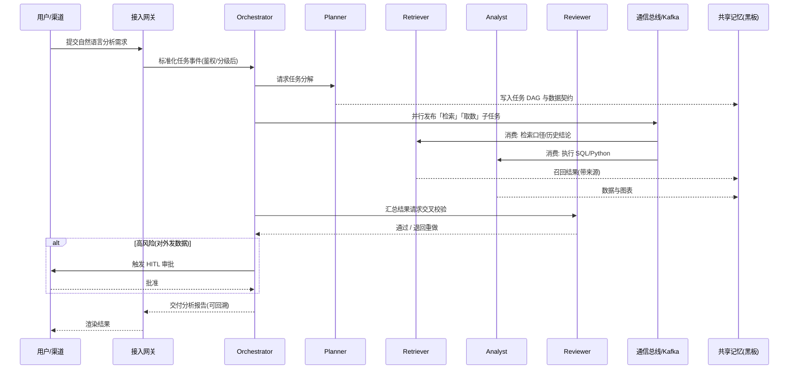

# 2. 系统架构设计（System Architecture）

## 2.1 总体架构图示

系统采用「分层解耦、事件驱动、状态外置」的微服务架构，自上而下分为七层。所有 Agent 均为无状态计算单元，任务状态统一外置到状态存储与共享记忆，实现任意实例可水平扩展、故障可重放。

```
┌──────────────────────────────────────────────────────────────────────────┐
│  表现层 Presentation   Web 控制台 │ 企业 IM(飞书/钉钉/企微) │ OpenAPI/SDK │ 工单系统
├──────────────────────────────────────────────────────────────────────────┤
│  接入网关层 Gateway     API 网关(Kong/APISIX) │ 认证鉴权 │ 限流熔断 │ 渠道适配
├──────────────────────────────────────────────────────────────────────────┤
│  应用层 Application     任务管理 │ 会话管理 │ 编排服务 │ HITL 审批 │ 配额计费
├──────────────────────────────────────────────────────────────────────────┤
│  智能层 Agent Layer                                                    │
│   ┌─────────────┐   规划Planner │ 检索Retriever │ 分析Analyst │ 编码Coder    │
│   │ Orchestrator│──▶测试QA │ 评审Reviewer │ 写作Writer │ 办理Operator │ 审计Guardian│
│   │ (DAG 状态机) │      （无状态专家 Agent 池，K8s 弹性伸缩，灰度版本）          │
│   └─────────────┘                                                         │
├──────────────────────────────────────────────────────────────────────────┤
│  能力层 Capability   大模型网关 LLM Gateway │ 工具执行沙箱(MCP) │ RAG 检索引擎
├──────────────────────────────────────────────────────────────────────────┤
│  通信层 Messaging     Kafka(事件流) │ gRPC(同步) │ Redis Stream │ A2A/JSON-RPC
├──────────────────────────────────────────────────────────────────────────┤
│  数据层 Data           PostgreSQL(元数据) │ Redis(会话/短期记忆)             │
│                        向量库 Milvus(长期记忆/Knowledge) │ MinIO(产物/文件)   │
│                        Neo4j(知识图谱,可选) │ Vault(密钥) │ 审计日志(只增)    │
├──────────────────────────────────────────────────────────────────────────┤
│  基础设施 Infra    Kubernetes │ Istio │ Prometheus+Grafana │ Loki │ OTel │ CI/CD
└──────────────────────────────────────────────────────────────────────────┘
           安全纵贯：认证授权(RBAC+ABAC) │ 输入过滤 │ 输出审计脱敏 │ 数据加密 │ 隐私合规
```

**任务执行时序（以数据分析流水线为例）：**



---

## 2.2 核心组件说明

### 2.2.1 调度中心（Orchestrator）

- **职责**：任务路由分发、DAG 状态推进、并行/串行编排、冲突解决、异常重规划、人工节点触发。
- **实现方式**：基于 **LangGraph 的图状态机（StateGraph）** 作为主编排内核。每个节点是一个 Agent 或工具调用，边表达依赖与条件分支；利用 LangGraph 的 **Checkpointer** 将图状态持久化到 PostgreSQL，支持任务暂停、断点续跑、时间旅行调试（重放/回滚）。
- **路由分发**：Planner 产出的 DAG 经校验后，由 Orchestrator 按节点就绪度向 Kafka 投递子任务；同层无依赖节点并行执行，竞速（Race）场景取最快合格结果。
- **冲突解决**：多 Agent 结论冲突时，采用「Reviewer 仲裁 + 证据引用数 + 置信度」加权裁决；仍不可判定则升级人工，不静默二选一。
- **熔断保护**：每个任务携带 `max_steps`、`max_tokens`、`max_retries`、`deadline` 四大约束，由 Orchestrator 统一计数，超限即熔断。

### 2.2.2 共享记忆库（Shared Memory）

采用**三层记忆 + 单一黑板**架构，状态外置、读写分离：

| 记忆层级 | 载体 | 生命周期 | 内容 | 一致性策略 |
| :--- | :--- | :--- | :--- | :--- |
| **工作记忆（短期）** | Redis + LangGraph Checkpoint | 单次任务 | 中间变量、步骤状态、DAG 运行态 | 任务内强一致，TTL 过期 |
| **黑板（Blackboard）** | Redis Hash/Stream + PG 落盘 | 单次任务 | 各 Agent 共享产物，支持订阅通知 | 条目级版本号（乐观锁） |
| **长期记忆** | Milvus 向量库 + PostgreSQL | 跨会话持久 | 事实、用户偏好、历史结论、知识条目 | 带来源、时间、密级；可删除/更正 |

- **写入**：Agent 产物先经 Schema 校验与 Reviewer 抽检，再写入黑板；被标记为「可沉淀」的结论经清洗后向量化入长期记忆。
- **检索**：长期记忆采用「向量召回（bge-m3）+ 关键词 BM25 混合检索 + Reranker 精排」，返回结果必须携带 `source / timestamp / confidence`，并按用户数据权限做行级过滤。
- **遗忘与合规**：支持按用户/数据源删除（受 GDPR/个保法的删除权）、TTL 自动过期、记忆条目审计，避免错误记忆永久污染。

### 2.2.3 通信总线（Communication Bus）

同步与异步分离，按场景选型：

| 通信方式 | 技术 | 适用场景 | 关键机制 |
| :--- | :--- | :--- | :--- |
| **异步事件流（主）** | **Kafka** | 子任务分发、Agent 解耦、削峰、事件回放 | 按 `task_id` 分区保证同任务有序；消费者组弹性扩缩；至少一次投递 + 幂等消费 |
| **同步调用** | **gRPC** | Orchestrator 对 Planner/Reviewer 的实时短调用、内部服务间高性能通信 | Protobuf 契约、超时/重试/熔断（istio） |
| **轻量即时消息** | Redis Stream | 黑板变更通知、HITL 实时推送、低延迟协作 | 消费组 + 消息确认 |
| **Agent 互操作** | **A2A（Agent2Agent）/ JSON-RPC over HTTP** | 跨团队/外部 Agent 能力互通、标准化 Agent Card 发现 | 任务对象（Task）生命周期、制品（Artifact）交换 |
| **工具接入** | **MCP（Model Context Protocol）** | Agent 对接外部工具与上下文资源 | 标准化 tools/resources/prompts，工具白名单 |

- **状态同步**：以「事件溯源（Event Sourcing）」为唯一事实源——所有状态变更产生不可变事件写入 Kafka 与审计库，当前状态由事件回放得出；任一副本重启后依据 Checkpoint + 事件追平，杜绝多副本状态不一致。
- **幂等与补偿**：每个子任务携带全局幂等键 `task_id + node_id + attempt`；写操作天然幂等；跨工具的长事务采用 **Saga 模式 + 补偿动作**，失败可回滚已执行步骤。

### 2.2.4 大模型网关（LLM Gateway）

- 统一 OpenAI 兼容接口，后端接入 GPT/Claude 等海外模型与 DeepSeek、Qwen、豆包等国产模型及私有化部署模型。
- **分级路由**：简单分类/抽取走小模型（低成本低延迟），复杂规划/推理走强推理模型；按任务标签自动选模，失败按优先级链降级。
- 提供：负载均衡、供应商健康检查、自动重试与熔断、流式转发、Token 与成本计量、Prompt 模板与版本中心、敏感词前置拦截、全量请求落盘（加密）用于审计与回放。

### 2.2.5 工具执行沙箱（Tool Sandbox）

- Agent 生成的代码/SQL 在隔离沙箱执行：容器级隔离（gVisor / 容器 NetworkPolicy 禁外网白名单）、只读根文件系统、临时可写卷、CPU/内存/超时配额、无持久凭证。
- 工具按最小权限授权，高危工具（删改数据、外发、支付）强制二次确认与 HITL。
- 所有工具调用记录入参、出参、执行者与结果，供审计与重放。

### 2.2.6 安全中心（Guardian，横切所有层）

- **认证授权**：OIDC/OAuth2 统一认证；RBAC 管角色、ABAC 管数据属性（密级/部门/owner），Agent 以其「服务身份 + 发起人身份」双重继承权限，禁止越权访问数据。
- **输入过滤**：在网关与 RAG 召回两道关口做 Prompt Injection、越权指令、敏感内容检测；外部检索内容以「不可信数据」隔离标注，禁止其中的指令被执行。
- **输出审计**：结构化输出校验 + DLP 数据防泄漏（身份证/手机号/银行卡/密钥/财务数字正则与模型双识别）+ 脱敏后外发；高风险输出强制 HITL。
- **数据隐私**：传输 TLS 1.3、存储 AES-256、密钥由 Vault 管理；支持租户级数据隔离、私有化/离线部署、数据留存与删除策略、操作审计日志只增不改。
- **供应链安全**：第三方工具/MCP Server 白名单与签名校验，容器镜像扫描，最小镜像与非 root 运行。

---

## 2.3 技术栈选型

### 大模型层
- **主力模型（多供应商可切换）**：DeepSeek-R1/V3、Qwen3、豆包 Doubao（推理与中文业务），GPT/Claude（复杂规划与代码，按合规与网络条件选用）；私有化兜底采用 Qwen/DeepSeek 开源权重本地部署。
- **Embedding**：bge-m3（多语种、稠密+稀疏向量）；**Reranker**：bge-reranker-v2；**轻量分类**：Qwen 小尺寸模型。
- **网关**：自研/基于 LiteLLM Proxy + 自研路由策略的统一 LLM Gateway。

### Agent 框架选型（三者分工，非互斥）

| 框架 | 特性 | 在本项目中的定位 |
| :--- | :--- | :--- |
| **LangGraph** | 图状态机、Checkpoint 持久化、HITL、流式、可重放，工程化程度高 | **主编排内核**：承载 Orchestrator 与生产级 DAG 工作流 |
| **AutoGen** | 对话驱动多 Agent、GroupChat、人机协作，适合开放式协同探索 | 用于「多 Agent 辩论/评审」与需要自由对话协商的子环节 |
| **CrewAI** | Role/Task/Crew 角色化建模，上手快、业务流程表达直观 | 用于新业务场景的快速原型（POC）验证，成熟后迁移到 LangGraph |

### 后端框架与语言
- **核心服务**：Python 3.11 + **FastAPI**（Agent 与编排生态，异步）；高并发网关/渠道路由用 **Go**（Gin/gRPC）补充。
- **RPC 契约**：gRPC + Protobuf；对外 REST 由 grpc-gateway / FastAPI 暴露。
- **任务调度**：LangGraph Runtime + Kafka 消费者；定时任务用 Celery beat / 自研 Scheduler。

### 数据与中间件
- **关系/元数据库**：PostgreSQL 16（任务、DAG、Checkpoint、权限、审计索引）。
- **缓存/会话/黑板**：Redis 7（Cluster 模式）。
- **向量数据库**：Milvus（规模化长期记忆与知识库）；早期可用 pgvector 平滑过渡。
- **消息队列**：Kafka（事件流主骨干）；Redis Stream 补轻量通知。
- **对象存储**：MinIO（产物文件、图表、文档、请求留档）。
- **知识图谱（可选）**：Neo4j，用于复杂实体关系与根因分析场景，非 MVP 必需。
- **密钥管理**：HashiCorp Vault。

### 基础设施与可观测
- **运行时**：Docker + Kubernetes（HPA 按队列长度/CPU 弹性扩缩 Agent Worker）。
- **服务网格**：Istio（mTLS、流量治理、熔断、灰度）。
- **监控指标**：Prometheus + Grafana（成功率、延迟、Token 成本、队列堆积、工具失败率）。
- **日志**：Promtail/Loki + 审计专用只增存储。
- **链路追踪**：OpenTelemetry（以 `task_id` 贯穿网关→编排→Agent→模型→工具全链路）。
- **IaC 与流水线**：Terraform + GitLab CI/GitHub Actions（代码扫描、镜像构建、自动化测试、灰度发布）。
- **质量保障**：LangSmith / 自研评测平台做 Prompt 与链路版本的离线评测、回归与灰度对比。

### 前端
- React 18 + TypeScript + Vite；DAG/任务流可视化使用 **React Flow**；图表用 ECharts；编辑器用 Markdown 编辑器 + 代码高亮；支持 SSE/WebSocket 流式输出与审批待办。

### 部署形态
- **默认**：Kubernetes 私有化部署（满足数据不出域）；
- **提供**：单机 docker-compose（开发/演示）、 Helm Chart（生产）；
- **多租户**：命名空间 + 数据库行级策略 + 向量库分区实现逻辑隔离，强隔离场景采用独立租户命名空间。

---

## 2.4 架构对关键非功能需求的支撑

| 非功能需求 | 设计手段 |
| :--- | :--- |
| **高可用** | Agent 无状态多副本 + K8s 自愈；Kafka/PG/Redis/向量库集群化；模型多供应商降级；状态外置支持实例故障后任务重放 |
| **可扩展** | Agent 与工具均为插件，按统一契约热注册；能力层与业务层解耦，新增场景仅需新增 Agent/图定义 |
| **一致性** | 事件溯源单一事实源 + 幂等键 + 乐观锁 + Saga 补偿，保证多 Agent 协作无状态分叉 |
| **可观测** | 全链路 OTel + 任务/成本看板 + 只增审计日志，每结论可回溯来源、模型版本与责任 Agent |
| **安全合规** | 三级权限 + 双道输入过滤 + 输出 DLP 审计 + 沙箱隔离 + 加密与 Vault + 私有化部署 |
| **成本可控** | 模型分级路由 + Token 预算熔断 + 语义缓存（相似问题命中）+ 小模型前置，整体成本可配额、可预警 |
